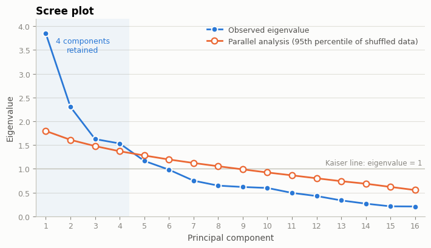
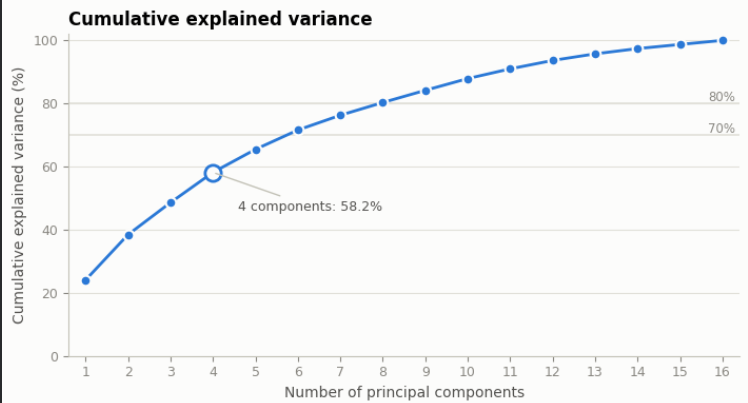
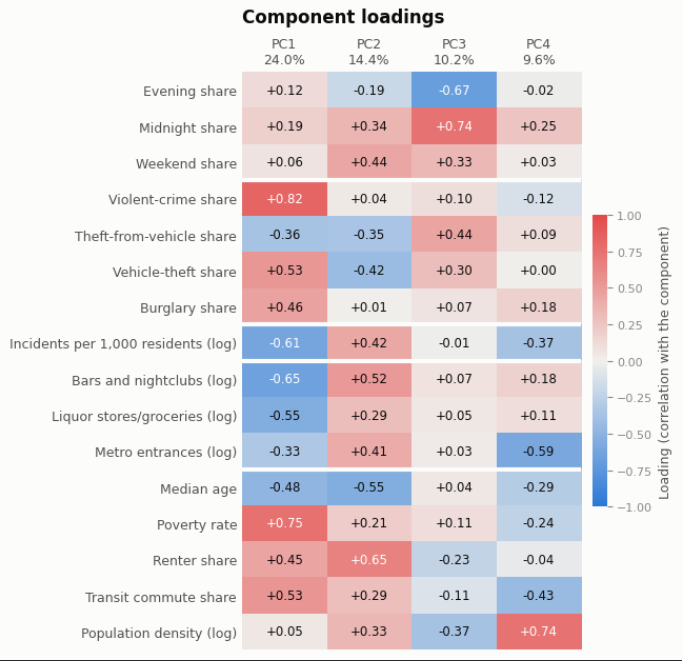
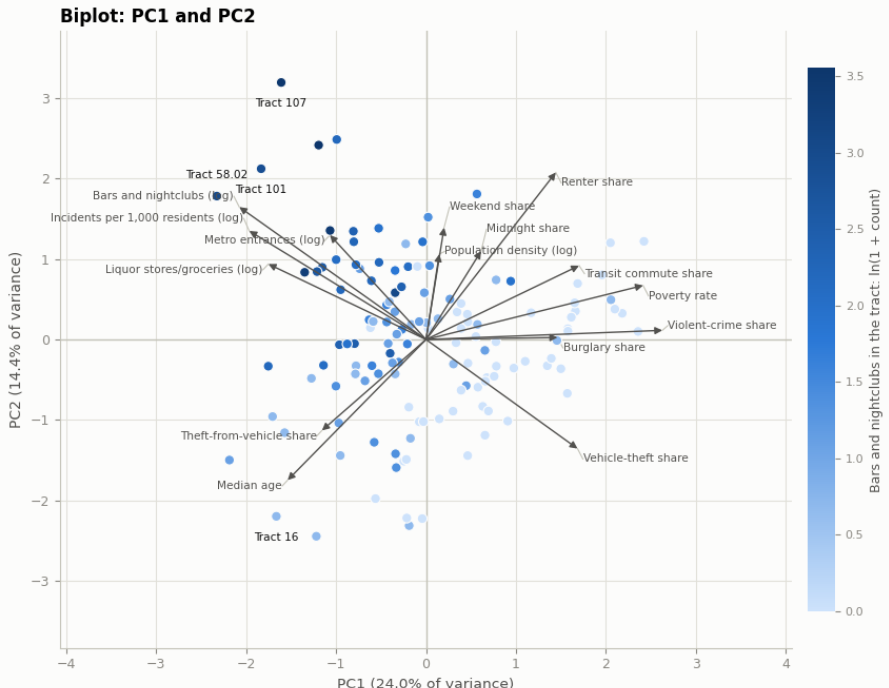

## 1. Integrating Primary and Supplementary Datasets
Our main dataset is the 2025 DC crime incident file. We integrated it with two supplementary datasets: Alcohol License Business Locations & Metro Station Entrances.

| Dataset | Provider/Publisher | Unit | Role |
|---|---|---|---|
| Crime Incidents in 2025 | DC Metropolitan Police Department | 1 reported incident | Time and offense mix of crime |
| Alcohol License Business Locations | Alcoholic Beverage and Cannabis Administration | 1 license | Nightlife measures |
| DC Metro Station Entrances | Washington Metropolitan Area Transit Authority | 1 station entrance |Transport access |
| Census Tracts in 2020 | DC Open Data |1 tract polygon | Geography for the combinations, 2020 population, housing units, and land area |
|---|---|---|---|

### 1. What each row represents
In the integrated dataset, one row represents one 2020 census tract in Washington, D.C. There are 206 rows, and every variable defines that tract's: timing and combination of its 2025 crime, the number of alcohol licenses and Metro entrances within it, and its population, ACS demographics, and land area. 

### 2. Identifiers that connect the datasets
The datasets are connected through the location where:

- Each license, incident, Metro entrance is allocated to a tract by spatial join against the 2020 tract polygons.
- The tract's GEOID (census identifier: 11001 + 6-digit tract code) is the merge key. The ACS table is combined with the same GEOID and the tract code is the last 6 digits of FIPS code.
- GEOID is utilized only to merge and name rows.

The crime file's CENSUS_TRACT column is not used because incidents within a tract polygon only agree with the 2020 polygons for about 82% and for 77 of 206 tracts. Additionally, the incident count varies by more than 20% between the two methods. Since the alcohol, Metro, population, and ACS data all lie on the 2020 polygons, and using it would merge conflicting geographic units.

### 3. Aggregation analyze needed for merging

Crime (incident -> tract, cleaning the dataset)
| Step | Rows removed | Rows left |
|---|---|---|
| Duplicates (CNN, OFFENSE, START_DATE | 3 | 24,153 |
| Incidents started outside 2025 | 216 | 23,937 |
| Incidents outside every tract polygon | 101 | 23,836 |

### Time:
Timestamps are in Coordinated Universal Time (UTC), so tracts are converted to Eastern time. Shift column is excluded since it follows report time, not incident time.

| Variable | Meaning |
|---|---|
| share_gun | Is the method a gun? |
| share_violent | Robbery, assault with a weapon, sex abuse, homicide |
| share_daytime | Started at 7:00 - 14:59 |
| share_evening | Started 15:00 - 22:59 |
| share_midnight | Started 23:00 - 6:59 |
| share_weekend | Started Saturday or Sunday|

Time-of-day and weekend shares are reported only for incidents reported within 1 day to reduce possible bias from reporting delays of time information. Data on time-of-day and weekend shares cover 17.998 incidents. timing_n states the number of incidents used to compute time-of-day and weekend shares for each tract. Time-of-day and weekend shares may underrepresent offenses that are more likely to be noticed later.

### Alcohol Licenses (License -> Tract)
2329 records -> 2,306 active or issued records, after removing duplicate records using license number -> 2,075 venue licenses, not including Internet, Third-Party Delivery, Caterer, Wholesaler, and Manufacturer licenses, all of which are likely offices or supply stores. All 2,075 venue licenses are in census tracts. Informative provided by census tract includes total licenses, bar and nightclub licenses, restaurant licenses, retail liqor licenses, and licenses with entertainment and dancing. Rates are computed per square kilometer of land area and per capita rates are not calculated because of downtown tracts having very few residents.

### Metro Entrances (Entrance -> Tract)
All 113 entrances are in census tracts (45 with entrances). Longitude and latitude data aren't available for Metro data. X and Y coordinates for Metro data are in meters using Web Mercator projection; this system is defined for Metro data, and a projection to longitude and latitude is applied during the join. 

### ACS (Tract -> Tract)
ACS table has one row per tract, so aggregation is not needed. We used its ACS columns (population, density, median household income, median age, poverty rate, renter share, transit-commute share). 

## 2. Refine the Research Question and Identify an Audience

### 1. Revise Research Question

#### Current Research Question: Are there 

## 3. Spatial Join

## 3. Data Preparation for PCA

Variables were prepared in the variable preparation notebook. See [Myles_Kiet_DC_Crime_PCA.ipynb](DC_Crime_PCA.ipynb).

- **Variables removed:** GEOID, TRACT, NAME. No categorical variables so no encoding required.
- **Filtering:** Tracts must have at least 30 well timed incidents. 32 tracts did not meet this criterion, leaving 174 tracts. No missing data for the PCA variables. No imputation required.
- **Variables (7):**

| Domain | Variable | Transformations |
|---|---|---|
| Timing | Evening proportion (15:00-22:59), Midnight proportion (23:00-06:59), Weekend proportion | Proportions |
| Alcohol and Transport | Total licenses, Bar/nightclub licenses, Dance licenses and Metro stations, all per km² land. | Log(1+x). |

- **Reason for Variable Selection:** Day proportion not included as the 3 proportions add up to 1. Number of licenses and stations have been divided by area (km²) to avoid larger tracts having an advantage. Density of entertainment licenses was not included as it had a high correlation (r=0.95) with total license density. Skewed values have been log transformed (e.g. total licenses reduced skewness from 2.3 to 0.2).
- **Variables intentionally not included in the PCA:** volume of crime, raw numbers, proportion of violent crime, proportion of guns, and ACS variables relating to residents. These are included as contextual information to understand the principal components, and as predictor variables for later classification analysis. By not including them in the PCA, we are able to explain clusters using variables which were not used to form the clusters.
- **Standardisation:** All variables have been converted to z-scores (mean=0, sd=1). This means the PCA is based on correlation and no variable dominates due to differing scales.
- **Outliers:** One tract has a value exceeding 3.5 standard deviations (Tract 15, weekend proportion). Tract 15 was not removed. Without it, results are unchanged (4.4).

## 4. PCA

### 4.1 Variance explained

| PC | Eigenvalue | % Variance | % Cumulative | Eigenvalue under random data (95th percentile) |
|---|---|---|---|---|
| PC1 | 2.91 | 41.5% | 41.5% | 1.41 |
| PC2 | 1.36 | 19.5% | 61.0% | 1.24 |
| PC3 | 1.01 | 14.4% | 75.4% | 1.13 |
| PC4 | 0.86 | 12.3% | 87.7% | 1.05 |
| PC5 | 0.52 | 7.4% | 95.1% | 0.97 |

2 principal components were retained (61.0% variance). Using parallel analysis with 1,000 permutations (seed 42), PC1 and PC2 are higher than would be expected with random data of the same shape. PC3 (1.01) is not (random data =1.13). Based on the Kaiser criterion (eigenvalues above 1), 3 components would be retained, however PC3 is barely above 1 (by 0.007). If 70% or 80% variance was desired, 3 or 4 would be required. To avoid retaining a component with no greater variance than expected by chance, 2 components were retained despite 39% variance loss. If 3 components are retained (PC3), this can be compared in the clustering stage.

### 4.2 Component Loadings

Loadings represent the correlation between variables and PC1/PC2.

| Component | High Loadings | Interpretation |
|---|---|---|
| PC1 (41.5%) | Bar/nightclub (per km²) (+0.92), total licenses (+0.91), dance licenses (+0.90), Metro (+0.46) | High density of alcohol licenses and Metro stations (intense night-life/commercial activity). Time of crime has low loadings (Weekend: +0.33, Midnight: +0.31). |
| PC2 (19.5%) | Evening (+0.81), Midnight (-0.79) | Evening peak (high) vs late-night (low). Little loading from license density (≤ 0.23). |

PC1 and PC2 are orthogonal. The level of alcohol and transport activity in a tract and time of crime are largely independent factors.

**Examples of high/low values:**

- **PC1 high:** 44.02 (U street, 56 licenses), 107 (Dupont Circle, 128 licenses, 8 Metros), 55.02, 58.01, 44.01.
- **PC1 low:** 27.03, 15, 68.02, 80.02, 18.03 (0-1 licenses).
- **PC2 high:** 102.01, 27.03, 38.02, 52.02, 28.02 (Midnight proportion 6-10%).
- **PC2 low:** 74.01, 56.01, 96.04, 111, 52.03 (Midnight proportion 34-49%).

**Results**

- License density is not predictive of late-night times. There is weak correlation between midnight proportion and bar/nightclub density (r=0.17) and total license density (r=0.09). For tracts in the top quartile of bar density, median midnight proportion is 19.3%. But for tracts in the bottom quartile, median midnight proportion is 18.9%.
- Some high nightlife density tracts have high late-night crime (44.02, 107, 55.02, midnight proportion 37-38%). Others do not (58.01, 38.02, 52.02 have high license densities, but are evening-peak).
- Other variables correlate with PC1 (Spearman correlation). Gun involvement (-0.38), violent crime (-0.29), Incidents per 1000 people (+0.39), Population density (+0.42), median income (+0.32), and poverty (-0.25). For tracts in the top quartile of bar density, median violent crime is 8.0%, and 15.3% in bottom quartile. Correlations with PC2 are weak (|r| ≤ 0.23).

| Context variable | PC1 | PC2 | Missing tracts |
|---|---|---|---|
| Violent-crime share | -0.29 | -0.14 | 0 |
| Gun-involved share | -0.38 | -0.21 | 0 |
| Incidents per 1,000 residents | +0.39 | +0.15 | 0 |
| Median age | -0.14 | +0.08 | 1 |
| Poverty rate | -0.25 | -0.22 | 0 |
| Renter share | +0.12 | 0.00 | 2 |
| Transit commute share | -0.15 | -0.04 | 0 |
| Population density | +0.42 | +0.19 | 0 |
| Median household income | +0.32 | +0.23 | 8 |

### 4.3 Biplot

Each dot corresponds to a tract. The colour indicates proportion of violent crimes in the tract (not an input to the PCA, included for interpretation only). Arrows indicate variable loadings. Arrows have been scaled up proportionally to increase clarity. Positively correlated variables have arrows in the same direction.

- The 3 license variables and metro station have positive loadings on PC1 (to the right).
- Evening has a positive loading on PC2 (upwards), and midnight has negative loading on PC2 (downwards).
- Tracts in the bottom-right corner of the biplot (44.02, 55.02, 56.01) have high license density and late-night crime.
- Tracts with a darker colour (more violent crime) are predominantly found on the left-hand side of the biplot, i.e. in tracts with low license density.

No clusters are identified from the PCA. Although some grouping of points appears to occur, true clusters in the data can only be identified after applying a clustering method. Therefore, these cannot be called clusters.

### 4.4 Robustness

Changing the minimum number of incidents in a tract to 20 or 50, removing the outlier or removing dance license density has very little effect on the results (PC1 and PC2). The loadings have high congruence (0.97-1.00). A PCA using just time of incidents results in a completely different pattern and is not comparable. Adding the license variables therefore provides additional information.

### 4.5 Extended Analysis (16 variables)

To check robustness, the proportion of offences, incidence rate and ACS resident variables were included (16 variables). 131 tracts were included (≥ 50 well timed incidents and ≥ 500 residents). Parallel analysis indicated 4 components should be retained (58.2% variance):

- **PC1 (24.0%):** Disadvantaged/violent mixes vs commercial areas
- **PC2 (14.4%):** young renters/weekend vs old residential areas
- **PC3 (10.2%):** late-night vs evening
- **PC4 (9.6%):** high residential density vs metro served areas

This supports the same conclusion, that late-night time of crime is largely unrelated to license density. However, as the additional variables included in this analysis are those we wish to retain for classification, this has not been used as the main analysis. Plots and tables can be seen in figures/extended/ and outputs/extended/.

## 5. Limitations and Next Steps

**Limitations:**

- Only correlation. 174 tracts included (out of 206). Tracts not included have very little recorded crime, meaning conclusions are based on tracts with more recorded crime.
- PC1 is largely dominated by one factor (license density). The 3 license densities have a high correlation (0.78-0.87).
- Noise in small tracts. Several extreme late-night values in small tracts (74.01, 56.01, 96.04), with only 32-35 well timed incidents. PC2 is robust (minimum 50 incidents, congruence 0.97), but the position of single tracts may not be accurate.
- Tract 9800 (17 residents, National Mall) has been included in the analysis. It is not flagged as an outlier on any variable, and its densities are calculated per km², not per person.
- Mixed time periods. Crime in 2025, ACS in 2020-2024, licenses in 2026, metro in 2016. 8 tracts (out of 174) have no median income.
